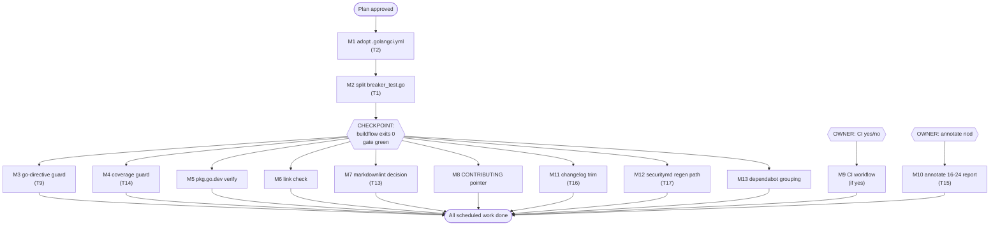

# Pareto Plan — Gate to Green, then Consumer Trust

> **EXECUTED 2026-11-22, same day, all 13 tasks complete** (owner approved
> full execution plus both gated decisions — CI: yes, annotate: yes).
> f09's gate-green checkpoint held through the final battery (buildflow 0,
> docs-gates 5/5, tests -race green); verdict trails in `CHANGELOG.md`,
> both status reports, and the living docs. Snapshot below is unmodified.

**Created:** 2026-11-22 18:43 · Crush (glm-5.3), pareto-planning skill ·
backlog basis: `TODO_LIST.md` (8 open rows after errata), `ROADMAP.md` (5 raw
ideas), both 2026-11-22 status reports, live verification of every open
claim.

**Inputs read first** (skill step 0): TODO_LIST.md, ROADMAP.md,
`docs/status/2026-11-22_16-24_*` and `2026-11-22_18-12_*`, git history
(`dad3511` owner commit landed mid-session). No prior plans exist in
`docs/planning/` — this is the first.

## Errata (stale backlog corrected at planning time)

- **T18 closed** — commit policy resolved by evidence: the owner commits
  directly (`dad3511` landed on top of agent work, already pushed; all repo
  history is owner-authored, no pma daemon pickup observed); agents commit on
  explicit request.
- **T8 closed** — premise dead: buildflow's test-coverage step auto-regenerates
  `reports/coverage.out` on every full run (observed refreshed 17:43, total
  98.4% matching a fresh profile). Gitignored-and-automatic is correct.
- **License question resolved by owner** (`dad3511`): Proprietary is
  intended; pkg.go.dev's UNKNOWN rendering is accurate. Not a plan item.
- **T1 evidence precision**: `wc -l breaker_test.go` says 353 lines (the gate
  finding said 354) — either way above the 350 cap; task unchanged.

## Pareto breakdown

- **The 1% that delivers 51%**: green the quality gate — `M1` (adopt
  `.golangci.yml`) + `M2` (split `breaker_test.go`). The library already
  works, is fully tested, and has seven consumers; the single thing standing
  between this repo and trustworthy future change is a gate that exits 0 and
  lint rules that fire before findings land.
- **The 4% that delivers 64%**: harden the verification story the gate now
  guards — `M3` (go.mod directive guard: the "Go 1.27 required" contract is
  currently an unguarded claim) + `M4` (coverage guard: FEATURES' 98.4% is
  hand-maintained).
- **The 20% that delivers 80%**: the consumer/public surface — `M5`
  (pkg.go.dev verification: the library's public face for every consumer),
  `M6` (link check), `M7` (markdownlint decision), `M8` (CONTRIBUTING
  pointer).
- **The other 20% to reach 100%**: hygiene and ops — `M9` (CI decision,
  owner-gated), `M10` (annotate the aged 16-24 report, owner-gated), `M11`
  (changelog trim), `M12` (securitymd regen path), `M13` (dependabot
  grouping).

**Deliberately NOT scheduled** (verschlimmbessern guard): all ROADMAP feature
ideas — sliding-window counting, per-breaker labels, `ExecuteCtx`, metrics
adapters. They are demand-gated with zero consumer demand signal; building
them now would be speculative scope creep on a library whose consumers asked
for none of it.

## Comprehensive plan (medium granularity, 30-100 min per task)

Sorted by importance / impact / effort / customer-value.

| Order | ID  | Task (30-100 min)                                                                                               | Covers  | Why this rank                                                                                                  | Effort  | Priority         |
| ----- | --- | --------------------------------------------------------------------------------------------------------------- | ------- | -------------------------------------------------------------------------------------------------------------- | ------- | ---------------- |
| 1     | M1  | Adopt `.golangci.yml` via `buildflow -s golangci-lint-auto-configure --fix`, review diff, fix surfaced findings | T2      | The gate's missing-infrastructure finding; lint rules prevent future findings — highest leverage single change | 45 min  | P1               |
| 2     | M2  | Split `breaker_test.go` (353 > 350 cap): move OnTransition tests to a second `_test.go` file                    | T1      | Second half of gate-green; unblocks exit 0                                                                     | 30 min  | P1               |
| 3     | M3  | Add go.mod `go 1.27` directive guard test (go-retry's `TestModuleGoDirectiveStaysPinned` pattern)               | T9      | Enforces the toolchain contract consumers compile against; sibling-proven pattern                              | 30 min  | P2               |
| 4     | M5  | Verify pkg.go.dev rendering for v0.2.0 (proxy propagation, doc extraction); fix doc comments if broken          | ROADMAP | The public face every consumer reads; tagged only yesterday, never verified                                    | 45 min  | P2               |
| 5     | M9  | CI decision (owner) and, if yes, a minimal Actions workflow running buildflow                                   | ROADMAP | Turns the local gate into an enforced one — biggest structural upgrade, needs owner call first                 | 100 min | P2 (decision P1) |
| 6     | M4  | Coverage guard: standing test asserting the FEATURES-cited coverage floor, or a recorded hand-maintain verdict  | T14     | Keeps FEATURES' one hardcoded number true                                                                      | 30 min  | P2               |
| 7     | M6  | Link check across README/docs; fix rot                                                                          | ROADMAP | Consumers must reach real targets (7 consumer repos + siblings linked)                                         | 30 min  | P2               |
| 8     | M7  | markdownlint decision: survey siblings, adopt config or record deliberate non-fix in AGENTS.md                  | T13     | Closes the last lint coverage gap — or honestly documents why it stays closed                                  | 30 min  | P3               |
| 9     | M8  | CONTRIBUTING.md: AGENTS.md pointer + fleet workflow note                                                        | ROADMAP | AI-assisted contributors onboard correctly                                                                     | 30 min  | P3               |
| 10    | M10 | Annotate the 16-24 report's eight completed §f rows (owner nod per ask-first canon)                             | T15     | Docs lifecycle hygiene; prevents stale-open reads                                                              | 30 min  | P3               |
| 11    | M12 | securitymd regen path: verify args preserve the manual SECURITY.md corrections; document                        | T17     | Prevents drift reintroduction by the next hygiene regen                                                        | 30 min  | P3               |
| 12    | M11 | Trim CHANGELOG `[Unreleased]` prose duplicating the eight purge lines                                           | T16     | Readability polish, single-source each fact                                                                    | 30 min  | P3               |
| 13    | M13 | Dependabot major-version grouping policy decision                                                               | ROADMAP | Maintenance cadence detail                                                                                     | 30 min  | P3               |

**Total: 13 tasks, ~8.4 hours.** Coverage check: T1, T2, T9, T13, T14, T15,
T16, T17 (all 8 open TODO rows) + all 5 ROADMAP raw ideas. Nothing dropped.

## Detailed breakdown (fine granularity, ≤ 12 min per task)

Sorted by importance; grouped by parent task.

| Order | ID  | Subtask (≤12 min)                                                                          | Parent | Effort |
| ----- | --- | ------------------------------------------------------------------------------------------ | ------ | ------ |
| 1     | f01 | Run `buildflow -s golangci-lint-auto-configure --fix`                                      | M1     | 5 min  |
| 2     | f02 | Review generated `.golangci.yml` against fleet defaults; accept or curate                  | M1     | 10 min |
| 3     | f03 | Run `buildflow -s golangci-lint`, triage every finding                                     | M1     | 10 min |
| 4     | f04 | Fix surfaced lint findings in `breaker.go` / `breaker_test.go`                             | M1     | 10 min |
| 5     | f05 | Full `buildflow`; confirm findings drop to file-size only                                  | M1     | 10 min |
| 6     | f06 | Move the OnTransition tests into `breaker_transition_test.go`                              | M2     | 12 min |
| 7     | f07 | Package/comment header for the new test file                                               | M2     | 5 min  |
| 8     | f08 | Verify both files under 350 lines; `go test ./... -race` green                             | M2     | 8 min  |
| 9     | f09 | **CHECKPOINT** — full `buildflow` exits 0 (gate green for the first time)                  | M2     | 10 min |
| 10    | f10 | Adapt `TestModuleGoDirectiveStaysPinned` from go-retry                                     | M3     | 12 min |
| 11    | f11 | Red-green check: bump go directive, watch test fail, restore                               | M3     | 10 min |
| 12    | f12 | Battery (docs-gates + dprint + tests) and commit                                           | M3     | 8 min  |
| 13    | f13 | Check proxy.golang.org propagation for the `v0.2.0` tag                                    | M5     | 5 min  |
| 14    | f14 | Fetch the pkg.go.dev page; verify state-machine diagram, Config docs, license block render | M5     | 10 min |
| 15    | f15 | Fix any broken doc comments; re-run battery                                                | M5     | 12 min |
| 16    | f16 | Record the verification outcome in FEATURES/ROADMAP; commit                                | M5     | 10 min |
| 17    | f17 | Owner decision: CI yes/no (blocks f18-f21 if no)                                           | M9     | 10 min |
| 18    | f18 | Draft minimal Actions workflow invoking buildflow                                          | M9     | 12 min |
| 19    | f19 | actionlint + workflow syntax verification                                                  | M9     | 12 min |
| 20    | f20 | Trigger a test run on a branch; confirm green                                              | M9     | 12 min |
| 21    | f21 | README badge + AGENTS repo-facts update if CI lands                                        | M9     | 10 min |
| 22    | f22 | Decide guard approach: coverage-floor test vs recorded verdict                             | M4     | 10 min |
| 23    | f23 | Implement the chosen approach                                                              | M4     | 12 min |
| 24    | f24 | Battery and commit                                                                         | M4     | 5 min  |
| 25    | f25 | Extract every link from README + living docs                                               | M6     | 5 min  |
| 26    | f26 | Verify each link; list rot                                                                 | M6     | 12 min |
| 27    | f27 | Fix rot; battery                                                                           | M6     | 10 min |
| 28    | f28 | Survey 3-4 sibling repos for `.markdownlint*` configs                                      | M7     | 10 min |
| 29    | f29 | Adopt a config (markdown-lint becomes applicable) or record the deliberate non-fix         | M7     | 12 min |
| 30    | f30 | Add AGENTS.md pointer + fleet workflow note to CONTRIBUTING.md                             | M8     | 10 min |
| 31    | f31 | Battery and commit                                                                         | M8     | 5 min  |
| 32    | f32 | Owner nod for annotating the 16-24 report (ask-first canon)                                | M10    | 2 min  |
| 33    | f33 | Strike the eight resolved §f rows inline with done-markers                                 | M10    | 12 min |
| 34    | f34 | Battery and commit                                                                         | M10    | 8 min  |
| 35    | f35 | Inspect securitymd usage: regeneration args, repo-specific fields                          | M12    | 10 min |
| 36    | f36 | Document the regen-safe procedure in AGENTS.md                                             | M12    | 12 min |
| 37    | f37 | Identify CHANGELOG prose bullets duplicating purge lines                                   | M11    | 5 min  |
| 38    | f38 | Trim to a single source per fact                                                           | M11    | 10 min |
| 39    | f39 | Battery                                                                                    | M11    | 5 min  |
| 40    | f40 | Decide major-version grouping policy; edit `dependabot.yml`                                | M13    | 10 min |
| 41    | f41 | Validate the config; battery                                                               | M13    | 5 min  |

**Total: 41 subtasks.** Coverage check: every medium task decomposed; every
TODO row and ROADMAP idea reachable from exactly one parent.

## Execution graph

Tiers: everything before `GATE` is the 1% that delivers 51%. M3+M4 are the
4% tier. M5-M8 are the 20% tier. M9-M13 are the other 20%. The two
owner-gated nodes (CI decision, annotate nod) are the only external
dependencies; everything else is sequenced and parallelizable after the
checkpoint.

---

_Point-in-time plan. When stale, ANNOTATE — do not rewrite (docs-health
policy). New tasks surfaced during execution go to `TODO_LIST.md` first; the
plan is a snapshot._
